<p align="center">
  
</p>

# Block

**Build your look, block by block.**  
Post-processing for Second Life viewers (OpenGL) on Windows, plus an experimental Vulkan layer on Windows/Linux — open source, human-made.

[](https://ape-squared.github.io/Block/)
[](https://github.com/ape-squared/Block/releases/latest)
[](LICENSE)
[](#using-block)
[](https://github.com/ape-squared/Block/actions/workflows/pr-checks.yml)

> This software is not provided, endorsed, or supported by Linden Lab, the makers of Second Life.  
> Not affiliated with ReShade or GShade.

[Why Block](#why-block) · [Block vs others](#block-vs-others) · [What works today](#what-works-today) · [Using Block](#using-block) · [Build](#build) · [Updates](#updates) · [Contributing](#contributing) · [Docs](#docs)

---

**Stack colour grading, bloom, sharpening and more — and see the cost in milliseconds.**  
**Firestorm, Alchemy, Black Dragon, and other OpenGL SL viewers on Windows today.**

> **Status:** early (0.x). Current release is **[v0.3.2](https://github.com/ape-squared/Block/releases/tag/v0.3.2)**. OpenGL Setup path is supported on Firestorm, Alchemy, and Black Dragon. Linux builds the Vulkan layer (Meson). See [docs/VIEWERS.md](docs/VIEWERS.md) and [docs/PLATFORMS.md](docs/PLATFORMS.md).

> **Human craft only.** We do not accept AI-generated contributions. PRs run authorship checks. Read [docs/AI_POLICY.md](docs/AI_POLICY.md).

## Why Block

| | |
|---|---|
| **OpenGL first** | Injector for Firestorm, Alchemy, Black Dragon, and friends |
| **GShade look parity** | `__GSHADE__` / `GSHADE_DITHER`, DEPTH / DEPTH_II, Intermediate cache when present |
| **Honest cost** | FX ms on OSD + one-click Trim heavy |
| **Depth that sticks** | Persist manual buffer picks; Depth OK strip; Generic Depth II for KeepUI |
| **Faster preset UX** | Favorites / recent, pin effects, pause FX when unfocused |
| **Safe addons** | OpenGL installs skip DXGI / DLSS / renodx; pick what you load |
| **One key overlay** | `Shift`+`B` — input blocked from the SL UI while open |

## Block vs others

Block is for **Second Life OpenGL viewers** with the **same ReShade FX / GShade presets** people already use — but as an **open-source** injector you can audit, build, and contribute to.

| | **Block** | **GShade** | **ReShade** | **vkShade / vkBasalt** |
|--|-----------|------------|-------------|-------------------------|
| **What it is** | Open-source SL-first injector + Setup | Closed-source ReShade fork + installer ecosystem | Upstream open-source injector (any game) | Linux Vulkan post-FX layers |
| **Source** | Public ([this repo](https://github.com/ape-squared/Block)) | Injector closed; shaders/presets on GitHub | Public | Public |
| **SL OpenGL (Firestorm, Alchemy, BD, …)** | Yes — Setup + `opengl32.dll` | Yes — primary SL package today | Works if you install manually | No OpenGL injector |
| **Runs your GShade / Heard presets** | Yes (wires GShade paths when present) | Yes (ships / manages packs) | Often needs macros / paths tweaked | FX subset on Vulkan only |
| **GShade look macros (`__GSHADE__`, dither, DEPTH_II)** | Built in | Built in | Not by default | N/A / limited |
| **Honest FX cost + Trim heavy** | Yes | Limited / different UX | GPU stats available; no Block Trim | Different tooling |
| **Depth persist + Depth OK strip** | Yes | Manual / per-session for some viewers | Generic Depth addon | WIP / limited depth |
| **Overlay key / SL click-through** | `Shift`+`B`, blocks input to SL UI | GShade overlay | Home / configurable | Layer-specific |
| **Forced updates / closed control panel** | No — GitHub Releases + optional OTA banner | Installer / control panel ecosystem | ReShade updater optional | Distro / AUR style |
| **AI-generated contributions** | Not accepted ([policy](docs/AI_POLICY.md)) | N/A | Upstream norms | Upstream norms |
| **Licence (runtime)** | BSD-2-Clause (see [NOTICE](NOTICE.md)) | Proprietary injector + mixed shaders | BSD-3-Clause | BSD-2 / zlib-family |

**In one line:** use **GShade** if you want their packaged installer and closed runtime; use **ReShade** for generic games; use **Block** if you want an **open, SL-oriented** injector that aims for **GShade look parity**, **honest cost**, and **contributor-friendly** releases.

Block **does not replace** GShade’s shader/preset library — when GShade is installed, Setup points Block at those shaders and presets. We are **not affiliated** with ReShade or GShade.

## What works today

| Backend | Artifact | Status |
|---------|----------|--------|
| **OpenGL (Windows)** | `opengl32.dll` via Block Setup | Supported — Firestorm, Alchemy, Black Dragon |
| **Vulkan (Win / Linux)** | `block.dll` / Meson layer | Experimental / CI builds on Linux |
| **Metal (macOS)** | — | Planned (native Metal rebuild; not this zip) |

**Overlay:** `Shift`+`B` · **Version:** [`VERSION`](VERSION) · **Licence:** [BSD-2-Clause](LICENSE)

### OpenGL (Windows viewers)

- Block Setup finds Firestorm, Alchemy, Black Dragon, Cool VL, Singularity, Kokua, …  
- Wires GShade shaders / Heard presets when present  
- Overlay blocks clicks from falling through into Second Life  
- Addon picker that stays OpenGL-safe (catalog under `%LOCALAPPDATA%\Block\addons-catalog`)  
- Crash dumps + next-launch prompt with a prefilled GitHub issue draft  
- Update check against GitHub Pages `latest.json`

### Vulkan (experimental) · Linux

- `VK_LAYER_BLOCK_post_processing_64` for apps that load instance layers  
- Linux: build with Meson (see [docs/PLATFORMS.md](docs/PLATFORMS.md)); CI compiles on every PR  
- Derived from [vkShade](https://github.com/ralgar/vkShade) — see [NOTICE.md](NOTICE.md)

### macOS

Not supported yet. A future Mac Block would be a **Metal** rebuild (native bridge + packaging), not Wine of the Windows zip.

## Using Block

1. Download the latest [Windows release zip](https://github.com/ape-squared/Block/releases/latest) or build from source ([Build](#build)).  
2. Run **Block Setup** and check every OpenGL viewer you use.  
3. Launch the viewer. In-world, press **`Shift`+`B`**.  
4. Browse presets (e.g. `gshade-presets\Heard\`) and toggle techniques.

Logs: `ReShade.log` next to the viewer (OpenGL), or a custom path from Settings. Prefer pasting log text in issues — not screenshots of screenshots.

## Build

### Windows (OpenGL injector — primary)

Visual Studio Build Tools (MSVC) required.

```bat
powershell -ExecutionPolicy Bypass -File tools\build_reshade_block.ps1
powershell -ExecutionPolicy Bypass -File tools\stage_block_runtime.ps1
powershell -ExecutionPolicy Bypass -File tools\build_block_setup.ps1
tools\BlockSetup.exe
```

Vulkan layer on Windows (experimental):

```bat
tools\build_windows.bat
tools\stage_block_runtime.ps1
```

```bat
set ENABLE_BLOCK=1
set VK_LAYER_PATH=%CD%\build-win\runtime\vulkan
set VK_INSTANCE_LAYERS=VK_LAYER_BLOCK_post_processing_64
vkcube
```

### Linux (Vulkan layer)

```bash
meson setup build-linux -Dcpp_std=c++23
meson compile -C build-linux
```

Details: [docs/PLATFORMS.md](docs/PLATFORMS.md).

## Updates

When a new version ships:

1. Bump [`VERSION`](VERSION) and `third_party/reshade/include/block_version.h`  
2. Tag `vX.Y.Z` — CI writes [`website/latest.json`](website/latest.json) and opens a GitHub Release  
3. Setup and the overlay (`Shift`+`B`) show **There's a new Block update available** with a link to Releases  

Channel: https://ape-squared.github.io/Block/latest.json

## Contributing

Open contributions welcome — from **humans**.

- Read [CONTRIBUTING.md](CONTRIBUTING.md) and [docs/AI_POLICY.md](docs/AI_POLICY.md)  
- Be honest about viewers; do not claim untested support  
- One concern per PR; say what you tested (viewer + GPU)  

Pull requests use the [PR template](.github/PULL_REQUEST_TEMPLATE.md). Bugs use the [issue form](https://github.com/ape-squared/Block/issues/new/choose).

## Docs

| | |
|--|--|
| [website/](website/) | Product site (GitHub Pages) |
| [docs/VIEWERS.md](docs/VIEWERS.md) | Firestorm, Alchemy, Black Dragon, … |
| [docs/PLATFORMS.md](docs/PLATFORMS.md) | Windows · Linux · macOS / Metal |
| [docs/HANDBOOK.md](docs/HANDBOOK.md) | Repo map and principles |
| [docs/AI_POLICY.md](docs/AI_POLICY.md) | Stance against AI-authored contributions |
| [ARCHITECTURE.md](ARCHITECTURE.md) | How the two backends fit together |
| [NOTICE.md](NOTICE.md) | Upstream credit and provenance |
| [CONTRIBUTING.md](CONTRIBUTING.md) | How to contribute |
| [THIRD_PARTY_LICENSES.md](THIRD_PARTY_LICENSES.md) | Licence notices |

## Credits

Incorporates and evolves [vkShade](https://github.com/ralgar/vkShade) (Ryan Algar, BSD-2-Clause).  
OpenGL path builds on [ReShade](https://reshade.me/).  
Not affiliated with Linden Lab, Second Life, ReShade, or GShade.
